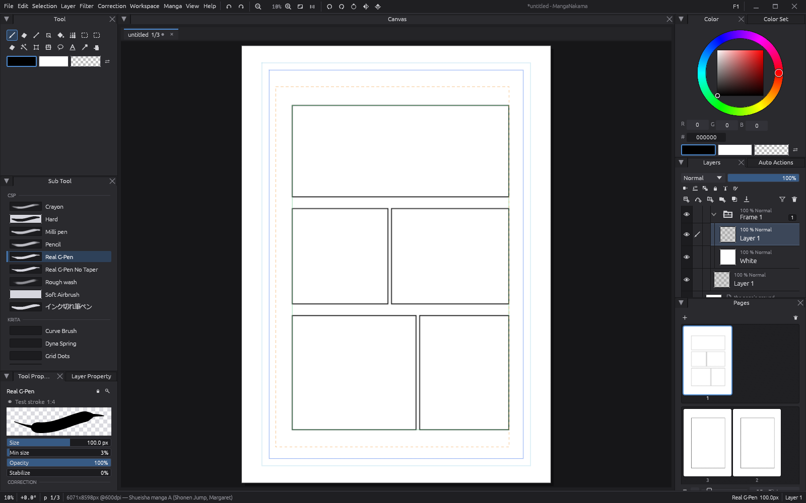

# MangaNakama



A free, GPU-first manga drawing app for Windows. Local files, no cloud, no
account, no subscription. MIT OR Apache-2.0. The expected basics are all
here — inking, panels, screentone, balloons, vertical Japanese text,
multi-page chapters — but the point is what's **better than Clip Studio
PAINT**:

- **Search everything (Ctrl+K).** Every command, brush, sub tool, material,
  layer, page, auto action and setting from one box. CSP's official answer
  to "too many clicks" is buying a hardware remote.
- **A built-in chapter reader.** Read your pages as right-to-left spreads,
  fullscreen; spot a mistake, jump to it, fix it, return to the same
  spread. The export → WinRAR → CBZ-viewer proofreading loop is gone.
- **Auto Actions you can actually edit.** Recorded command sequences with
  inline parameters, drag-to-reorder steps, per-run step toggles, and one
  press of undo for a whole run — with a Scratch-style colourful block
  editor on the way.
- **Panels numbered by reading order,** recomputed live as frames move,
  with an on-canvas reading-path overlay. CSP numbers panels by creation
  order and never recovers.
- **Page setup you can change your mind about.** Resize a work's pages
  after creation, across every page in one pass — the decision CSP makes
  permanent at File ▸ New.
- **Brushes from everywhere.** Photoshop `.abr`, GIMP, Krita, and Clip
  Studio's own `.sut` read directly — or lasso your own marks and register
  them as a stamp brush, tuned on a live test stroke.
- **One-gesture tone.** Click an enclosed region and a live, editable tone
  layer lands on exactly that area. No four-palette dance, no mask
  thumbnail hunting.
- **Pattern Studio.** Draw on a wrap-around tile, watch it repeat live,
  save it as a material in one click — versus CSP's register-material
  ceremony.
- **Text styles on the work.** Edit "dialogue" once and every balloon on
  every page reflows. CSP's own tutorial warns that a mid-chapter font
  change means fixing every page by hand.
- **Panels that let art burst out** while the frame stays editable, and
  white knockout mats generated from the art itself — no rasterizing, no
  hand-painted "White" layers.
- **One dock tree, canvas included.** The canvas is a pane like any
  palette: split, tab, tear off, open pages side by side.
- **Requests get built.** The roadmap is fed by what CSP's own tutorials
  and forums confess is hard — and by whoever opens an issue. Ask for
  something.

In flight right now: the Scratch-style block editor, themes and a coloured,
customisable UI, searchable tabbed preferences, and publisher print
profiles. Early development, moving fast — [`ROADMAP.md`](ROADMAP.md) is
what works today and what comes next.

**[Read my Webtoon here.](https://mangadex.org/title/6a08b268-e032-4198-a53a-ef705e592dc3/tekno)**

## Why this exists

An open alternative for mangaka who can't justify Clip Studio PAINT's price
tag — or who are tired of a CPU-bound pipeline that makes big brushes, tone
layers and selected-area rotation feel like the 2000s. **Everything that can
run on the GPU, runs on the GPU** is the rule this app is built to — the
"More" fold at the bottom continues this in detail.

## Download

Grab the zip from the [Releases](../../releases) page, unzip it anywhere, run
`manganakama.exe` — keep `assets/` and `manual/` beside it. Windows 10/11,
64-bit; no installer, nothing touches the registry, deleting the folder is
the uninstall. If something breaks, open an issue and attach
`manganakama.log` from beside the exe: it names the build, your GPU, and any
crash, and it is deliberately free of anything personal, so it is safe to
post. (Attach that one file — its neighbour `recent.txt` holds full paths
with your Windows user name in them.)

## Build & contribute

Windows only. `git clone`, follow [`SETUP.md`](SETUP.md) (Rust GNU toolchain
plus one portable GCC — no Visual Studio), then:

```
./build.sh            # debug build
./build.sh --release  # the build you draw with
./build.sh --test     # the full suite — green with zero warnings before a PR
```

Read [`CONTRIBUTING.md`](CONTRIBUTING.md) (TL;DR in its first line) and
`docs/ARCHITECTURE.md` — especially its **"Traps"** section — before
changing anything. `ROADMAP.md` ends with a list of good first issues.

## Would be nice to have

### Compact tiles: removing the last second from effect lines

**What you notice.** Placing or editing speed lines, focus lines or a solid
flash (ベタフラ) on a full B4 page at 600 dpi takes about 0.5–1.5 s (a solid
flash about 4–5 s). Roughly 1 s of that is not drawing at all: it is the
cost of getting memory for the new layer.

**Why it happens, step by step.**

1. A page is cut into small squares called *tiles* (64 × 64 pixels). Each
   pixel in a tile is stored as 4 colour values of 2 bytes each (16-bit
   RGBA), so one tile is 64 × 64 × 8 bytes = **32 KB**, even if it holds a
   single black line.
2. Speed lines cross the whole page, so nearly every tile gets some ink. A
   B4 page at 600 dpi has about **12,800 tiles**, so one effect layer needs
   about 12,800 × 32 KB = **420 MB** of new memory.
3. When a program asks Windows for new memory, Windows first fills it with
   zeros. It must: the memory may have belonged to another program a moment
   ago, and that program's data (passwords, documents) must not leak. Every
   program on every modern OS gets this.
4. Clearing 420 MB to zero takes Windows about **1 second** on a typical
   laptop. Measured here: building 12,825 tiles costs 0.9–1.3 s, and almost
   all of it is the zeroing, not our code.

**What was already tried (and why it does not help).**

- *Asking for zeroed memory the cheap way*: already done (`vec![0; n]` /
  `alloc_zeroed`). The cost is the zeroing itself, which cannot be skipped.
- *Not creating tiles that get no ink*: already done. Speed lines simply
  touch 6,000–12,800 tiles.
- *Re-using old tiles instead of asking Windows for new ones*: undo keeps
  the old tiles alive, so there is nothing free to re-use.

**The fix that would work: compact tiles.** Most effect-line tiles contain
only one colour (black) on transparent. Such a tile could be stored as
"1 bit per pixel (ink / no ink) + the ink colour": 64 × 64 bits = 512 bytes
instead of 32 KB, which is 64 times less memory. The full 32 KB version is
only built at the moment something actually needs the full pixels (for
example when you paint on that tile with a soft brush).

- Saves the ~1 s on every effect-line regen, and a lot of memory per page.
- It changes how every tile is stored, so every piece of code that reads
  tile pixels has to learn the compact form. Estimate: 1–2 days, high risk.

**A smaller version: one-colour tiles.** A tile that is entirely one colour
(the inside of a solid flash) stores just that colour and no pixels. This
only helps the solid flash (about 0.9 s of its time), but it is about half
a day of work.

Want to take this on? Open an issue first; the measurements and a step
plan exist and can be shared there.

### A memory budget: "let MangaNakama use X % of RAM"

**The idea.** Photoshop has a setting like *"Let Photoshop use 70 % of
RAM"*. A program with a budget like that can take memory from Windows once,
keep it, and hand it out again and again inside the program. Windows only
zeroes memory the first time it gives it out (see above), so after the
first use the ~1 s per effect layer would mostly disappear: re-used memory
is already ours and needs no zeroing.

**Why it does not work today.** Re-using memory only helps if old tiles
are ever given back. In MangaNakama the undo history keeps every old tile
in RAM at full size, so memory only grows and nothing is free to re-use.

**What it would take.**

1. A setting (Preferences ▸ Performance): "Use up to N % of RAM", with a
   sensible default such as 50 %.
2. A tile pool: freed tiles go back into the pool instead of back to
   Windows, and new tiles come from the pool first.
3. Undo history that can shrink: when the budget is reached, the oldest
   undo steps are compressed (most tiles are mostly empty, so they compress
   very well) or moved to a file on disk, like Photoshop's "scratch disk".
   That frees their memory for the pool.
4. Combined with compact tiles (above), most of the budget would rarely be
   needed at all.

Steps 2 and 3 touch the undo system and the tile store, so this is a larger
change than it sounds (several days); it also makes the app far better on
big multi-page works, not only for effect lines.

### A faster canvas redraw on big pages

**What you notice.** On a B4 page at 600 dpi (the Japanese submission size,
about 6,000 × 8,600 pixels) the canvas is slow to catch up with some actions.
Hiding or showing a layer, changing a layer's opacity or blend mode, or
opening the page takes 1–4 s before the picture is right. During normal
drawing, each screen refresh costs about 70 ms of CPU time even when only
2–3 tiles changed, so the app runs at roughly 14 frames per second instead
of 60. (Measured in the owner's log on an Intel UHD 620: a 3-tile frame
99 ms, a full-page rebuild 958 ms to 4.0 s.)

**What this is.** The *compositor* is the part that stacks all layers into
the one picture you see. It runs on the GPU. The slow part is not the GPU
work: it is the CPU bookkeeping around it. Every frame, the code walks over
every tile of every layer to decide what changed, then records one draw
call per layer per screen region. On a 12,800-tile page that walk and that
recording are most of the 70 ms, and a full rebuild repeats them for every
tile. Strokes are unaffected (lanes 2 and 3 in the git history fixed
effect lines and the pen stall); this is purely redraw cost.

**The plan that exists** (`docs/plans/2026-10-01-perf-lane1-composite.md`):

1. Measure first. Split the frame timer into four buckets (scan, upload,
   encode, submit) and add a headless benchmark on a B4 page with three
   layers.
2. Fix only the biggest bucket: dense per-grid bitmaps instead of hash sets
   if the scan dominates; fewer, batched draw calls if the encoding
   dominates. No threading of GPU calls (the UHD 620 DX12 driver drops
   tiles when wgpu is touched from several threads).
3. Prove the pixels are identical before and after with the existing CPU
   compositor as the reference.

Parked because the app already feels fine for inking after the 2026-11
fixes; the remaining cost is felt on layer-panel actions on very large
pages. About a day of work plus a day of measuring.

### Lasso selection: show the line while you draw it

**What you notice.** With the lasso (free-hand) selection tool, nothing is
drawn while you trace around the area. The outline only appears after you
let go of the pen or mouse, so you are tracing blind and cannot see whether
you are following the edge you meant.

**What it should do.** Like Clip Studio and Photoshop: while the pen is
down, draw the path traced so far as a thin line on the canvas (ideally
with a faint closing line from the pen back to the start point, so you can
see the area that would be selected if you let go now). On release, the
normal selection outline replaces it.

**Where it would go.** The lasso already collects the points while the pen
moves (it needs them to build the selection on release); this is only a
matter of drawing those points in the canvas overlay each frame, the same
way the Figure tool previews a shape while it is being dragged.

---

<details>
<summary><b>More: what's under the hood, and the tester's guide</b></summary>

### Why this exists, in more detail

The GPU rule is a direction, not a finished claim. On the GPU today: the
whole compositor (layer blending, group flattening, tile upload, display)
plus brush dab rasterization behind `--gpu-dabs`. Gradients, transforms and
filters are still CPU; they are the queue.

PSD import and export run on a vendored copy of storytold/photocraft's
`psd` crate (`vendor/photocraft-psd`). The previous in-house PSD writer is
still in the code and stays there: `psd_legacy_writer=1` in the preferences
file switches back to it. No removal is planned.

Inking runs on a libmypaint engine with Krita-inspired modes (hard-stamp
tips, scatter, wash/flow-vs-opacity, texture tips, symmetry, wrap-around
tiling, a sketch/hatching engine). Manga structure is CSP-style: panels and
frame folders with reading-order numbering, screentone and live tone/
gradient layers, balloons, a story editor, layer comps, multi-page work
folders, and the reader. The full test suite runs on every push
(`.github/workflows/ci.yml`, windows-latest, GPU tests on the WARP software
adapter). The pen path is raw Win32 pointer input — no winit; we own the
tablet path end to end.

### Tester's guide

You don't need to build — grab a release exe, draw, and report. The log
(`manganakama.log` beside the exe, or `%LOCALAPPDATA%\MangaNakama\` if the
folder is read-only — press **F1**, the Diagnostics window shows the real
path with a copy button) records the build, the graphics adapter, whether
strokes ran GPU or CPU, any `CANARY REPAIR` lines (automatic recovery when
a driver drops GPU work — pixels stay correct, the line is telemetry), and
a `!!! PANIC` line if the app ever dies. A session block that does not end
with `=== exited cleanly ===` is a crash — exactly what we want to see.
Reproduce the problem right before attaching so the relevant session is the
last block.

Heavy things worth hammering on:

1. **Rotation + zoom** — rotate the canvas, zoom deep in and out, draw
   through all of it; report lag spikes or vanishing strokes.
2. **GPU brush path** — run with `--gpu-dabs`, compare pen feel against the
   default; F1 shows the live dab path. A `gpu → cpu repair!` status is the
   canary defense firing — please attach the log.
3. **Software-renderer mode** — `--warp` forces the CPU-simulated GPU; any
   difference between normal and `--warp` runs is a driver bug worth an
   issue.
4. **Long, fast strokes** — pages of hatching, fast diagonal slashes,
   pressure ramps; look for lag, gaps, or seams at tile borders.
5. **Symmetry + tiling** — View ▸ Symmetry X/Y and Tile X/Y: draw across
   canvas edges with tiling on, mirror with X+Y active.
6. **Tone layers** — Layer ▸ Convert to tone layer; draw inside one, change
   frequency/angle, undo through it, save + reload.
7. **Transform + undo chains** — Ctrl+T, scale/rotate, Enter, then Ctrl+Z
   repeatedly; the canvas must restore exactly.
8. **Multi-page works** — create a comic work folder, switch pages while
   drawing, autosave, close + reopen; page files must survive.

Issue shape: what you did, what you saw, what you expected, the log file,
and your GPU (the log's first line has it).

### License

MIT OR Apache-2.0, at your option — see [LICENSE-MIT](LICENSE-MIT) and
[LICENSE-APACHE](LICENSE-APACHE). Vendored components keep their own
licenses (`vendor/libmypaint` is ISC); the full third-party inventory is
[`THIRD-PARTY.md`](THIRD-PARTY.md).

</details>
